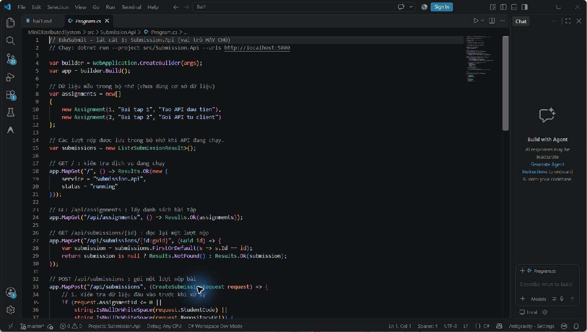
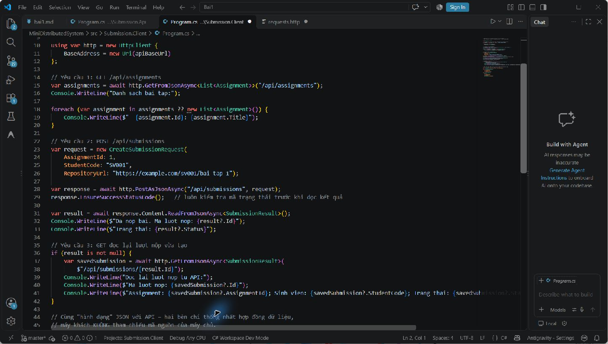
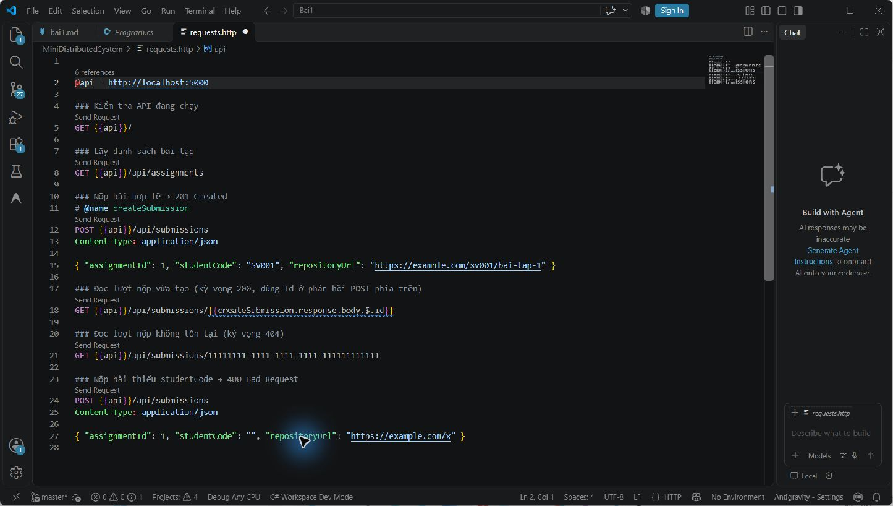
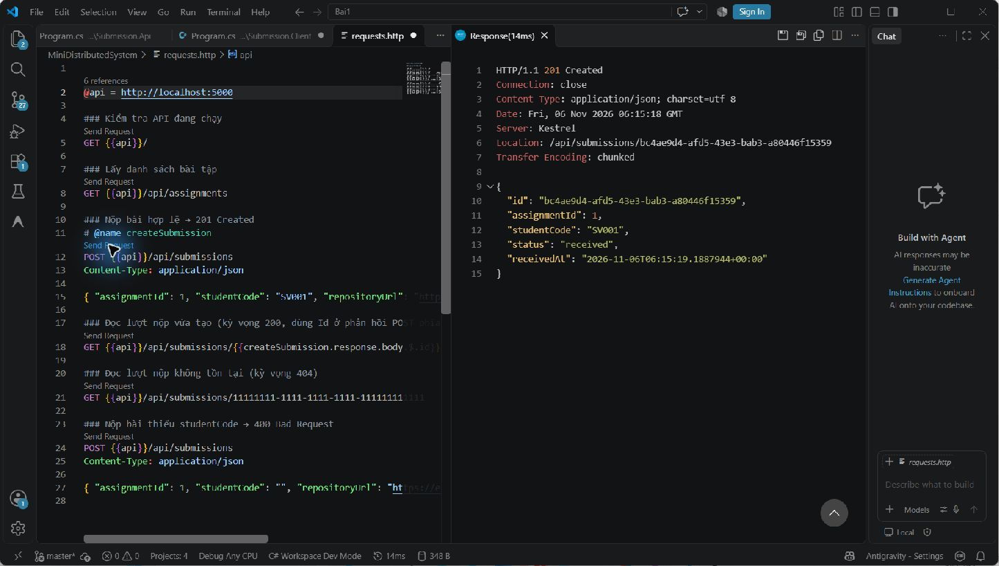
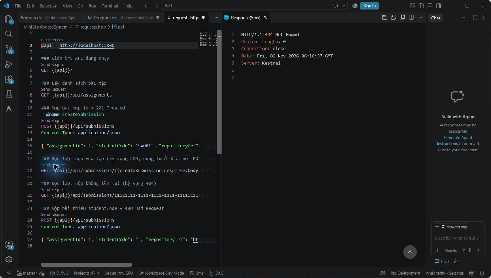

# Bài 1 – Tổng quan hệ thống và MEP

Họ tên: Tạ Tuấn Anh  
MSSV: DTC245200697  
Lớp: CNTT K23D

## 1. Cài đặt

Đã thực hiện build các project .NET trong bài. Ảnh chụp bước cài đặt chưa có trong thư mục hiện tại; cần bổ sung nếu giảng viên yêu cầu minh chứng riêng cho Bước 4.

## 2. MepDemo (Bước 7)

- MEP 1 – Request–response: client gửi yêu cầu và chờ phản hồi; có thể timeout nếu xử lý lâu.
- MEP 2 – One-way: bên gửi phát thông điệp rồi tiếp tục công việc, không chờ kết quả nghiệp vụ.
- MEP 3 – Queue-based: các worker lấy việc từ hàng đợi; mỗi `sub-x` chỉ do một worker xử lý.
- MEP 4 – Publish–subscribe: một sự kiện được phát tới cả ba dịch vụ đã đăng ký.
- MEP 5 – Streaming: client nhận các cập nhật trạng thái liên tiếp trong khi tác vụ đang chạy.

## 3. BasicWebApi (Bước 8)

API minh họa `GET /` và `GET /hello/{name}` trả `200 OK`, POST `/greetings` hợp lệ trả `201 Created`, dữ liệu rỗng trả `400 Bad Request`.

1. `builder.Services.AddSingleton(...)` phải đứng trước `builder.Build()` vì dịch vụ phải được đăng ký trước khi ứng dụng được tạo.
2. Trong `/hello/{name}?language=en`, `name` lấy từ route; `language` lấy từ query string.
3. POST tạo một tài nguyên mới nên `Results.Created` trả `201` cùng `Location` để client biết địa chỉ tài nguyên; `200` thường dùng cho yêu cầu thành công không tạo mới.

Ảnh minh chứng BasicWebApi (200/201/400) chưa có trong thư mục hiện tại; bổ sung nếu cần nộp toàn bộ các bước trước.

## 4. MiniDistributedSystem (Bước 9)

- Client gọi `GET /api/assignments` (200) và `POST /api/submissions` (201); ở Bước 12, client gọi thêm `GET /api/submissions/{id}` (200 khi có lượt nộp).
- Client không tham chiếu mã nguồn API. Hai bên thống nhất qua HTTP và hợp đồng JSON/record có cùng hình dạng.
- URL API được truyền qua đối số dòng lệnh để chuyển môi trường hoặc cổng mà không sửa mã nguồn client.

Ảnh chụp hai terminal của Bước 9 chưa có trong thư mục hiện tại.

## 5. Thí nghiệm lỗi (Bước 10)

| # | Dự đoán | Thực tế | Đúng/Sai | Giải thích |
|---|---|---|---|---|
| **a** | Client không cần sửa code khi API thêm bài tập thứ ba. | Client có thể lấy và in cả ba bài tập vì nó duyệt danh sách nhận được. | **Đúng** | Dữ liệu được trao đổi qua HTTP/JSON; số lượng phần tử không bị cố định trong vòng lặp của client. |
| **b** | Tắt API thì client không kết nối được. | Client phát sinh `HttpRequestException` (connection refused). | **Đúng** | Client và API là hai tiến trình độc lập; giao tiếp mạng phụ thuộc vào API đang chạy và cổng truy cập. |
| **c** | Gửi `StudentCode` rỗng sẽ bị từ chối. | API trả `400 Bad Request`; `EnsureSuccessStatusCode()` ném ngoại lệ cho phản hồi lỗi. | **Đúng** | Server phải tự kiểm tra dữ liệu vì request có thể đến từ client khác hoặc được gửi trực tiếp, bỏ qua giao diện client. |
| **d** | Client sẽ lỗi nếu API chuyển từ cổng 5000 sang 5050 nhưng client vẫn dùng 5000. | Truyền URL mới khi chạy client (`-- http://localhost:5050`) giúp kết nối mà không sửa code. | **Đúng** | Client đọc URL từ `args[0]`; nếu bỏ trống thì mới dùng địa chỉ mặc định. |

## 6. Dự án EduSubmit tự làm (Bước 11–12)

API giữ lượt nộp trong `List<SubmissionResult>` khi tiến trình đang chạy. Sau POST, client lấy GUID và GET lại lượt nộp. GET trả `200 OK` nếu tìm thấy, `404 Not Found` nếu không có. Dữ liệu trong danh sách mất khi khởi động lại API.

- Ảnh code API: 
- Ảnh code client đọc lại lượt nộp: 
- Ảnh các request: 
- Kết quả POST: 
- Kết quả GET không tồn tại: 
- Kết quả kiểm tra lượt có thật: `GET /api/submissions/{id}` trả 200 và đúng GUID/dữ liệu đã POST. Lượt 200 được xác minh bằng client và kiểm tra API cục bộ.
- Phần đối chiếu code mẫu: chưa ghi nhận việc phải xem code mẫu khi làm Bước 11–12.

Luồng thông điệp:

```text
Client --(HTTP GET /api/assignments)--> Api : request–response, 200 OK
Client <--(danh sách bài tập)----------- Api

Client --(HTTP POST /api/submissions)--> Api : request–response, 201 Created
Client <--(SubmissionResult có Id)------ Api

Client --(HTTP GET /api/submissions/{id})--> Api : request–response, 200 OK
Client <--(SubmissionResult đã lưu)-------- Api

Client --(HTTP GET /api/submissions/{id} không tồn tại)--> Api : request–response, 404 Not Found
```

## 7. Khó khăn gặp phải và cách giải quyết

Cổng 5000 đã có một tiến trình API cũ sử dụng. Để kiểm tra bản cập nhật Bước 12 mà không dừng tiến trình đó, chạy API mới trên cổng 5001 và truyền `http://localhost:5001` cho client. Danh sách lượt nộp là dữ liệu trong bộ nhớ nên cần POST lại sau khi khởi động API mới.
